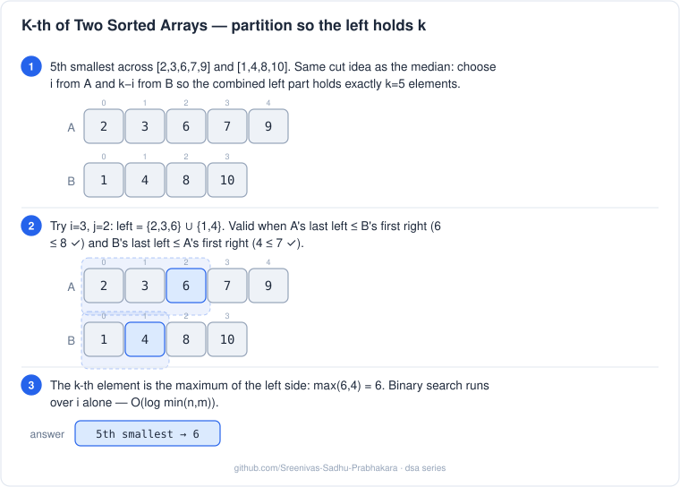

# K-th Element of Two Sorted Arrays

> Striver SDE Sheet 066 · Day 11 Binary Search — the median partition search, re-aimed: take k elements across both left sides and validate the cut. Go, stdlib only, tested.

## Problem

Two sorted arrays; return the k-th smallest element of their combined order (1-based) in logarithmic time, without merging.

## Approach

The two-array median is secretly this problem with k = half — so generalize the partition: choose i elements from the first array's front and j = k − i from the second's, and binary search i until the cross conditions hold (`aLeft ≤ bRight && bLeft ≤ aRight`). The answer is then the larger of the two left-boundary values — the biggest of the k chosen. One new wrinkle versus the median: i's search range must be clamped to `[max(0, k−m), min(k, n)]`, since j must stay inside the second array. Out-of-range k returns ok=false instead of a junk value.

**Complexity:** O(log min(n, m, k)) time, O(1) space.

## Visual walkthrough

Read the picture top to bottom — each numbered frame is one moment of the algorithm
running on this repo's test example.

## Run

    go test ./...   # verify
    go run .        # demo

---

One of 191 repos solving Striver's SDE Sheet in Go — stdlib only, one problem per repo, every solution tested. Browse the set: [`dsa-*` repos](https://github.com/Sreenivas-Sadhu-Prabhakara?tab=repositories&q=dsa-&type=source).
